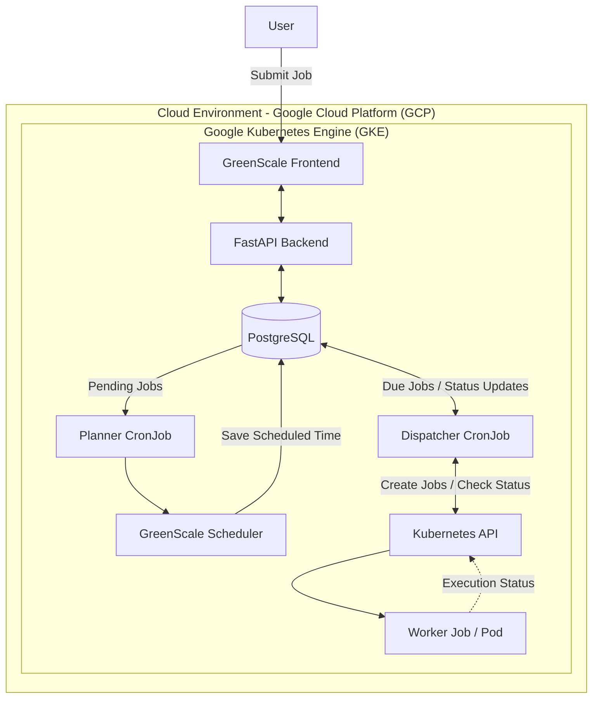

# GreenScale - Flexible Kubernetes Job Scheduler

## 1. Overview

GreenScale is a electricity price-aware, cloud-native system for scheduling flexible batch jobs in Kubernetes. Users describe a task in simple natural language, and an LLM converts the request into structured job details such as the task name, priority, deadline, and estimated execution time. GreenScale then validates and stores the job information, decides whether the job should run immediately or wait for a suitable execution window based on priority, and creates the job in Kubernetes at the selected time. It also tracks the job until completion and stores its execution status and timing information and displays on GreenScale website.

### Problem

Not every batch job is urgent. Reports, data processing, backups, compression, and other batch tasks can often be delayed. Running flexible work at a preferred time can help organizations use computing resources more efficiently.

The course prototype uses configurable preferred windows. Live electricity or carbon data is outside the current core scope.

### Core Goals and Features

* Accept jobs with priority, deadline, and estimated execution time.
* Decide whether each job should run immediately or wait for a suitable execution window.
* Create and track the job as a Kubernetes Job.
* Store scheduling history and job status.

### Demonstrating Success

The system will be considered successful when it can:

1. Accept CSV demo jobs.
2. Schedule them according to the defined rules.
3. Launch the jobs in Kubernetes.
4. Track their completion.
5. Show the scheduling result through the API.

## 2. Architecture

### High-Level Architecture

### Main Components

* **User:** Submits a batch job through the GreenScale website and checks its scheduling and execution status.
* **GreenScale Frontend:** Provides the interface for submitting jobs and viewing their details and results. It communicates with the FastAPI backend.
* **FastAPI Backend:** Receives and validates job requests, stores job records in PostgreSQL, and returns job information and status to the frontend.
* **PostgreSQL:** Stores submitted jobs, their metadata, selected start times, scheduling decisions, and execution statuses. It connects the API, planner, and dispatcher.
* **Planner CronJob:** Runs periodically to examine pending jobs in PostgreSQL and invoke the GreenScale scheduling logic.
* **GreenScale Scheduler:** Uses job priority, deadlines, estimated runtime, and available electricity-price information to choose a feasible start time. The planning process saves the selected time and decision in PostgreSQL.
* **Dispatcher CronJob:** Periodically checks PostgreSQL for jobs due to run, submits them through the Kubernetes API, and updates stored statuses after checking execution progress.
* **Kubernetes API:** Receives Job creation requests from the dispatcher and exposes the status of Kubernetes Jobs.
* **Worker Job / Pod:** Runs the submitted batch workload in a container. Kubernetes reports whether the Job succeeds or fails.
* **Google Cloud Platform (GCP) / Google Kubernetes Engine (GKE):** Provides the cloud environment where the GreenScale application and its Kubernetes workloads run.

### Data Flow

1. **Job submission:** The user submits a job through the GreenScale frontend. The frontend sends the request to FastAPI.
2. **Validation and storage:** FastAPI validates the job metadata and saves a new record in PostgreSQL, initially marked `PENDING`.
3. **Planning:** The Planner CronJob reads pending jobs from PostgreSQL and invokes the GreenScale Scheduler. The planner uses runtime estimates and electricity-price information to evaluate scheduling options.
4. **Scheduling decision:** The scheduler selects a feasible start time based on priority, deadline, estimated runtime, and price. The planning process records the selected time and decision reason in PostgreSQL.
5. **Dispatch:** The Dispatcher CronJob checks PostgreSQL for jobs whose scheduled start time has arrived and uses the Kubernetes API to create their Kubernetes Jobs.
6. **Execution:** Kubernetes runs each submitted workload in a worker Pod. The job may become `RUNNING` and eventually succeed or fail.
7. **Status synchronization:** The dispatcher checks Kubernetes Job status through the Kubernetes API and updates PostgreSQL with the execution outcome (`SUCCEEDED` or `FAILED`). FastAPI retrieves the stored information for the frontend.

**Note:** The planner and dispatcher run independently and communicate through PostgreSQL. The scheduler does not send jobs directly to the dispatcher, and workers do not report directly to PostgreSQL.

### State

PostgreSQL is the persistent source for GreenScale job metadata, scheduling decisions, scheduled start times, and recorded statuses. Kubernetes maintains the live state of running Jobs and Pods. The dispatcher periodically reconciles Kubernetes execution status with the records in PostgreSQL.

### API Contract

The planned API endpoints are:

* `POST /jobs` — Submit a new job.
* `GET /jobs` — List submitted jobs.
* `GET /jobs/{id}` — Get details and status for a specific job.
* `GET /health` — Health check.

## 3. Technologies

| Technology       | Role                              | Reason                                       |
| ---------------- | --------------------------------- | -------------------------------------------- |
| Python + FastAPI | REST API and scheduling logic     | Readable, testable, and easy to explain      |
| Docker           | Package GreenScale and demo jobs  | Provides reproducible builds and execution   |
| Kubernetes       | Run GreenScale and submitted Jobs | Core cloud technology for the course         |
| Kubernetes API   | Create and track Kubernetes Jobs  | Allows GreenScale to control batch execution |
| LLM API          | Process job metadata              | Converts user requests into structured scheduling metadata. |
| PostgreSQL       | Store jobs and scheduling history | Reliable persistent storage                  |
| GitHub Actions   | Automated testing                 | Verifies scheduling and API behavior         |

## 4. Deployment and Operations

### Target Platform

GreenScale will run as a containerized application in the cloud environment. Submitted demo workloads will run as Kubernetes Jobs.

### Infrastructure and Persistent Data

The core system will use:

* One GreenScale Deployment and Service.
* PostgreSQL with persistent storage.
* Kubernetes Jobs for submitted workloads.
* Kubernetes ServiceAccount and RBAC permissions for creating and reading Jobs.
* One or more simple demo job container images.

PostgreSQL will provide persistent storage for job metadata and scheduling history.

### Configuration and Secrets

Preferred execution windows and other non-sensitive configuration will use environment variables or a Kubernetes ConfigMap.

Database credentials will be stored in a Kubernetes Secret. Secrets will not be committed to Git.

### Security

GreenScale will use a dedicated Kubernetes service account with only the permissions needed to create and inspect Kubernetes Jobs. LLM output will be validated before the scheduler uses it. The LLM will not receive Kubernetes credentials or direct cluster access.

### Operations

The deployment will include:

* Health checks.
* Structured logs.
* Resource requests and limits.
* Automated tests.
* Deployment scripts.
* Verification scripts.
* Cleanup scripts.

### Expected Cost

The course version is designed to run in the provided cloud environment. A real deployment would mainly incur costs for compute resources and database storage.

## 5. Scope and Feasibility

The project is designed for a three-person group with approximately 50–60 total hours. The main focus is cloud scheduling, Kubernetes Jobs, persistence, automation, and verification rather than frontend development.

The scheduling rules are intentionally simple and deterministic so that the team can fully test and explain them.

### Core Scheduling Rules

* **HIGH priority:** Run immediately.
* **MEDIUM priority:** May wait if enough time remains before the deadline.
* **LOW priority:** Use the preferred execution window when the deadline allows.
* If delaying a job could cause it to miss its deadline, run it earlier.

### Core Deliverables

* Submit, validate, store, and list jobs.
* Schedule jobs using priority, deadline, estimated runtime, and configured preferred windows.
* Create and track Kubernetes Jobs.
* Deploy GreenScale and PostgreSQL with Docker and Kubernetes.
* Provide tests, health checks, logs, and automated deployment, verification, and cleanup.

### Stretch Goals

Only after the core system is stable:

* Integrate real electricity-price or carbon-intensity data.
* Support several preferred windows or multiple clusters.
* Add a summary of delayed versus immediately executed jobs.

### Milestones and Ownership

| Milestone                                         | Scope   | Owner                  | Effort  |
| ------------------------------------------------- | ------- | ---------------------- | ------- |
| API, data model, LLM integration, scheduling rules                 | Core    | Member 1 + team review | 12–15 h |
| Kubernetes Job integration + RBAC                 | Core    | Member 2 + team review | 12–15 h |
| Docker, PostgreSQL, deployment + operations       | Core    | Member 3 + team review | 12–15 h |
| Tests, automation, verification + report evidence | Core    | All members            | 10–11 h |
| One small extension if core is stable             | Stretch | Shared                 | 3–4 h   |

### Cloud and Operations Focus

The project emphasizes cloud infrastructure and operations through Kubernetes deployment, Kubernetes Job management, Role-Based Access Control(RBAC), persistent PostgreSQL storage, containerization, health checks, logging, automated testing, and deployment/verification/cleanup automation.

### Main Risk and Fallback

The main risk is scheduler timing and Kubernetes Job permissions. The team will first verify that a simple Kubernetes Job can be created and tracked through the Kubernetes API.

If advanced timing behavior becomes unreliable, the core system will use short controlled demo windows, such as a preferred window starting a few minutes later, so that the scheduling rules can still be verified reproducibly.
