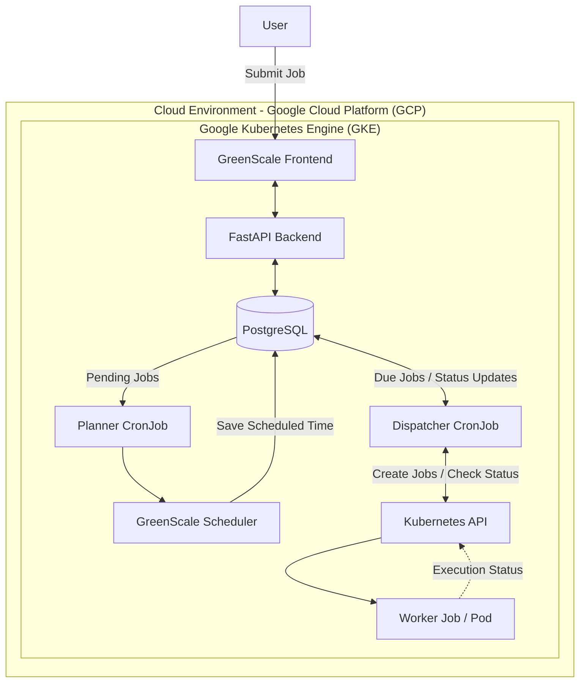

# GreenScale

**A cloud-native scheduler that runs flexible batch jobs on Kubernetes at a cheaper time, based on Norwegian (NO2) electricity prices.**

Users describe a job in plain language. GreenScale turns it into structured job details, picks a start time based on priority, deadline and electricity price, and then runs the job as a Kubernetes Job and tracks it until it finishes.

## Demo Video
 
[](https://youtu.be/ozNQ-zA3Qqc)
 
▶️ [Watch the demo on YouTube](https://youtu.be/ozNQ-zA3Qqc)

---

## Features

- **Natural-language job submission**: Gemini (LLM) converts a text request into job details.
- **Price-aware scheduling**: uses NO2 day-ahead spot prices from [hvakosterstrommen.no](https://www.hvakosterstrommen.no/strompris-api), together with job priority and deadline.
- **Runtime estimates**: Gemini estimates how long a job will take, with safe default values if the LLM is unavailable.
- **Kubernetes execution**: a planner CronJob schedules jobs (every 5 min), and a dispatcher CronJob starts them as Kubernetes Jobs and records the result (every minute).
- **Workloads**: `sleep`, `factorial` and `csv_summary` (CSV files uploaded to Google Cloud Storage).
- **User accounts**: registration and login, so each user sees only their own jobs.
- **Job control**: cancel or reschedule jobs, and view CSV summary results.
- **Health checks**: `/health` and `/ready` endpoints.

## Architecture



The planner and dispatcher run independently and share state through PostgreSQL.

## Tech Stack

| Area | Tools |
|---|---|
| Backend | Python 3.12, FastAPI, SQLAlchemy |
| Database | PostgreSQL |
| LLM | Google Gemini |
| Containers | Docker, Docker Compose |
| Cloud | GKE, Cloud Build, Artifact Registry, Cloud Storage |
| Kubernetes | Deployments, CronJobs, Jobs, RBAC, Caddy |
| CI / Testing | GitHub Actions, pytest |

## Project Structure

```
GreenScale/
├── app/          # FastAPI app: API routes, auth, scheduler, prices, LLM
├── execution/    # Dispatcher, Kubernetes job executor, worker
├── k8s/          # Kubernetes manifests
├── migrations/   # SQL migrations
├── static/       # Web UI (dashboard and login)
├── tests/        # pytest tests
├── scripts/      # Helper and check scripts
└── docs/         # Deployment runbook, observability, executor notes
DESIGN.md         # Full design document
```

## Run Locally

Setup and run instructions are in [GreenScale/README.md](GreenScale/README.md).

Run the tests (no database, LLM or cloud needed):

```bash
cd GreenScale
pip install -r requirements.txt
pytest
```

## Documentation

- [DESIGN.md](DESIGN.md): design, architecture and scheduling rules
- [GreenScale/README.md](GreenScale/README.md): installation, configuration and Kubernetes deployment
- [GreenScale/docs/](GreenScale/docs/): deployment runbook, observability and executor details

## Team

Group project for **DAT515** at the **University of Stavanger (UiS)**, 2026, by Group 24:

- Vaishnavi Chikhale
- Jarin Anika
- Mehedi Hasan Sabbir

The system was deployed on GKE during the course. The cloud project has since been shut down, so there is no live demo.
